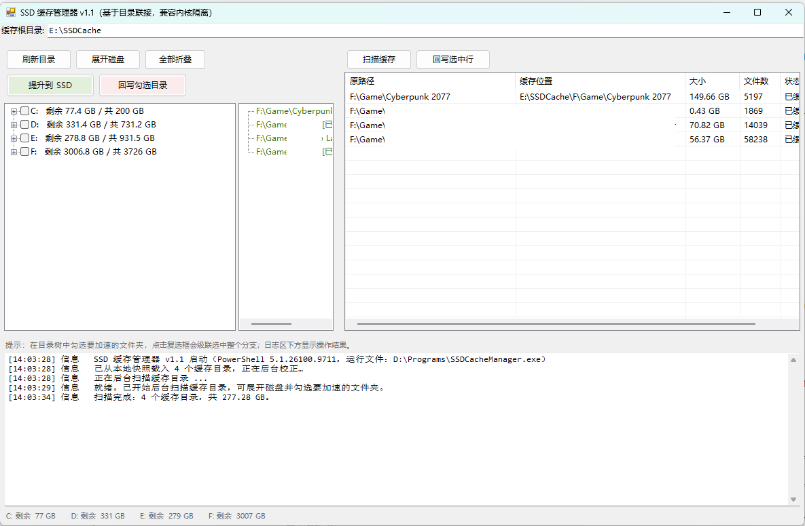

# SSD Cache Manager v1.1

基于 NTFS 目录联接（junction）的目录级 SSD 加速工具，兼容 Windows 11 26H2 及默认开启的内核隔离（HVCI / 内存完整性）。

## 用途

把机械硬盘上常用的文件夹搬到 SSD 运行，**原路径与盘符不变**：`F:\Game\Cyberpunk 2077` 仍是这个路径，文件实际存放在 `E:\SSDCache\F\Game\Cyberpunk 2077`。程序、存档、Steam 库路径都无需修改。

| 目的 | 操作 |
|---|---|
| 加速某个文件夹 | 勾选 →「提升到 SSD」 |
| 还原到机械硬盘 | 勾选 →「回写勾选目录」 |
| 查看已加速目录 | 右侧缓存清单；目录树绿色文字即已加速 |
| 中途终止 | 进度条右侧 ×，自动断点续传，不丢数据 |

前提：仅支持 NTFS 卷；禁止操作 C 盘；需管理员权限（创建联接点要提权）。提升是**移动**而非复制，缓存盘需留出这些文件夹的体积。

## ⚠️ 数据安全与免责声明

本工具会**真实移动文件**并创建/删除 NTFS 联接点，属于对文件系统的破坏性操作。代码中虽有多重护栏（见「安全设计」），但**不构成任何数据安全保证**。

- **请勿把本工具用于没有备份的唯一副本**。使用前请先备份重要数据，或先在一个可丢弃的测试目录上试跑。
- 提升/回写过程中**不要断电、强制关机、拔出缓存盘，也不要手动改动缓存根目录**——否则数据可能分居源盘与缓存盘两侧，需要人工介入恢复。
- 开发过程中曾出现过一次因程序缺陷导致的**不可恢复数据丢失**（回滚逻辑误删缓存中的数据）。该缺陷已修复并加了护栏，但这说明此类风险是真实存在的。
- 若缓存目录显示「目标丢失」，**先不要删除任何一侧的数据**，按「故障排查」处理，或先复制出来再清理。
- 本软件按 MIT 许可「按原样（AS IS）」提供，不附带任何明示或暗示的担保。**作者不对因使用本工具造成的任何数据丢失、损坏、业务中断或其他损失承担责任。** 使用即表示你已理解并自行承担全部风险；如不接受，请勿使用。

## 为什么用目录联接

Windows 11 26H2 默认启用基于虚拟化的安全（VBS）与 HVCI。HVCI 在内核驱动**加载之前**校验其代码与签名，因此所有依赖内核过滤驱动的传统缓存工具都无法运行：

| 工具 | 是否被 HVCI 拦截 |
|---|---|
| PrimoCache、StarWind L2、O&O CleverCache | 是（内核过滤驱动） |
| Windows 存储空间缓存 | 是（内核驱动） |
| AMD StoreMI | 仅限 AMD 平台 |

目录联接（junction）是 NTFS 重解析点，在**用户态**解析，HVCI 不介入——因此本工具在 26H2 上无需关闭任何安全特性即可工作。

代价：本工具不是全盘透明的，你需要显式选择要加速的目录。

## 功能特性

- 目录树勾选 + 级联选中，支持批量提升 / 批量回写
- 数据量进度条（按字节计算的真实进度，单大目录迁移期间平滑推进）
- 长任务后台执行，界面全程可操作
- 每次操作写入日志；崩溃详情自动记录到 `%TEMP%\SSDCacheManager_crash.log`
- 全链路数据安全护栏（见「安全设计」）

## 系统要求

- Windows 10 / 11，NTFS 卷
- 管理员权限（创建联接点需要提权）
- 一块比源盘更快的盘作为缓存根（如 NVMe SSD）

## 文件说明

| 文件 | 作用 |
|---|---|
| `SSDCacheManager.exe` | 单文件成品（`build/` 目录，`build-exe.ps1` 生成）；双击运行，自带 UAC 提权，无控制台黑框 |
| `Start-SSDCacheManager.cmd` | 脚本版启动器（自动提权 + 放行执行策略） |
| `SSDCacheGUI.ps1` | WinForms 图形界面 |
| `SSDCacheLib.psm1` | 核心库模块（也可独立用于命令行） |
| `build-exe.ps1` | 打包脚本：合并源码并调用 ps2exe 生成单文件 exe |

## 使用方法（图形界面）


1. 顶部设置**缓存根目录**（如 `E:\SSDCache`）
2. 展开目标磁盘，勾选要加速的文件夹（点复选框会级联选中整个分支）
3. 点「提升到 SSD」并确认
4. 需要还原时勾选后点「回写勾选目录」，或在缓存清单中选中一行点「回写选中行」

目录树中已缓存的文件夹以绿色显示联接目标，随时可确认当前加速状态。

## 使用方法（命令行）

```powershell
Set-ExecutionPolicy -Scope Process -ExecutionPolicy Bypass

Import-Module .\SSDCacheLib.psm1

# 查看当前缓存清单
Get-JunctionInventory -Roots 'F:\'

# 提升到 SSD
Invoke-CachePromote -SourcePath 'F:\Books' -CacheRoot 'E:\SSDCache'

# 回写机械硬盘
Invoke-CacheDemote  -SourcePath 'F:\Books' -CacheRoot 'E:\SSDCache'
```

## 构建

```powershell
.\build-exe.ps1
```

输出 `build\SSDCacheManager.exe`（单文件、无控制台、内嵌管理员清单）与 `build\SSDCacheManager-src.ps1`（合并源码，供审查）。依赖 ps2exe 模块（首次运行会自动从 PowerShell Gallery 安装）。

> 杀毒软件可能对 ps2exe 生成的 exe 误报，属该打包方案的已知代价；可加白名单或改用 cmd 启动器运行脚本版。

## 性能设计

即使面对数 TB 机械硬盘，界面也保持响应：

- **磁盘根节点不随启动展开**——递归展开会统计整盘每个文件夹（每盘约 6 秒），按需点开即可
- **缓存扫描在后台独立 runspace 执行**，结果由日志回报
- **目录大小只在提升时统计**，浏览过程不做任何递归测量
- **提升/回写在后台 runspace 执行**，进度条按数据量（字节）计算，每 2 秒由专用测量 runspace 刷新「已迁移量」；进度条下方明细行同时显示当前目录序号、本目录文件进度与正在复制的文件名。测量不占用 UI 线程，也不与 robocopy 争抢 IO

## 安全设计

**回写必须先拆联接点再写数据。** 顺序颠倒会让数据经联接点直接写回缓存，机械盘上目录为空——这是硬性顺序，代码中已固化并加注释。

代码中强制执行的护栏：

- 拒绝 `C:` 上的任何路径与整盘根目录
- 迁移失败自动把数据回滚到原位置
- 回写失败时给出恢复联接点的确切命令，数据保留在缓存侧
- 缓存目录仅在验证数据已落盘后才删除
- 每个缓存目录含 `.ssdcache_root` 标记文件（记录原始路径的 JSON），只有标记确认归属时才允许清理缓存目录，且标记在回写前会被移走，绝不混入用户数据

## 故障排查

**「在此系统上禁止运行脚本」**
用 `Start-SSDCacheManager.cmd` 启动，或先执行 `Set-ExecutionPolicy -Scope Process -ExecutionPolicy Bypass`。

**「需要管理员权限」**
右键 PowerShell 选择「以管理员身份运行」。

**缓存目录显示「目标丢失」**
缓存根被移动/重命名，或缓存盘未挂载。恢复原位置后执行回写，或手动把数据复制回去。

**空缓存目录无法删除**
终端防护软件可能拦截删除。数据已安全回到机械盘，属无害残留，手动删除即可。

**杀软报毒（exe）**
ps2exe 打包方案的已知误报。加白名单，或改用 cmd 启动器运行脚本版。

## 许可证

[MIT](LICENSE)
